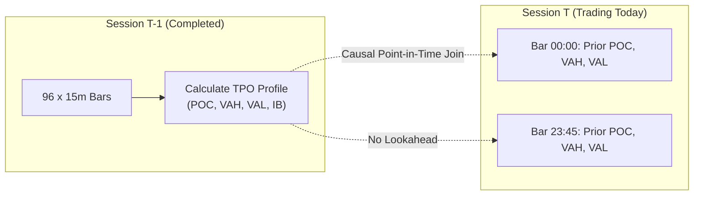

# Causal Market Profile & TPO Dual-Expansion Value Area Algorithm

[](https://www.python.org/)
[](https://opensource.org/licenses/MIT)
[]()
[](https://github.com/psf/black)
[]()

A high-performance, strictly causal Python implementation of **J. Peter Steidlmayer's Market Profile (CBOT, 1986)**, **Time-Price Opportunity (TPO)** bracket matrix construction, and the canonical **Dual-Expansion 70% Value Area Algorithm**.

Designed for quantitative researchers, algorithmic traders, and institutional backtesting engines requiring **mathematically rigorous Value Area boundaries (POC, VAH, VAL)**, **Auction Market Theory structural classification (D, P, b, B shapes)**, and **guaranteed zero-lookahead point-in-time causality**.

> **Security & IP Guarantee**: This repository contains **zero API keys, credentials, proprietary trading alpha strategies, or private validation gates**. It is an independent, pure mathematical and algorithmic library implementing public Auction Market Theory literature.

---

## Table of Contents

- [The Core Value Area Problem](#the-core-value-area-problem)
- [Key Capabilities](#key-capabilities)
- [The Dual-Expansion Algorithm](#the-dual-expansion-algorithm)
- [Auction Structure Classifications](#auction-structure-classifications)
- [Strict Point-in-Time Causality](#strict-point-in-time-causality)
- [Project Architecture](#project-architecture)
- [Installation](#installation)
- [Quick Start](#quick-start)
  - [1. Building a TPO Market Profile](#1-building-a-tpo-market-profile)
  - [2. Stepping through Dual Expansion](#2-stepping-through-dual-expansion)
  - [3. Profile Shapes & Auction Extremes](#3-profile-shapes--auction-extremes)
  - [4. Causal Prior-Session Attachment](#4-causal-prior-session-attachment)
  - [5. Volume Profile vs TPO Comparison](#5-volume-profile-vs-tpo-comparison)
- [Running Unit Tests](#running-unit-tests)
- [Academic & Industry References](#academic--industry-references)
- [License](#license)

---

## The Core Value Area Problem

In financial trading, the **Value Area (VA)** represents the price range where approximately 70% (1 standard deviation) of trading activity occurred during a session.

### The Naive Sorting Trap:
Many public scripts calculate Value Area by simply sorting price rows by frequency/volume in descending order and taking the top 70%.
- **The "Swiss-Cheese" Flaw**: In multi-modal or double-distribution sessions, sorting yields **discontinuous, non-adjacent price levels** with empty gaps in between.
- **Economic Inconsistency**: In real markets, value cannot logically exist at \$100 and \$110 while skipping \$105. A valid Value Area must be a **contiguous, topologically connected interval** $[\text{VAL}, \text{VAH}]$.

### The Dual-Expansion Solution:
The **Dual-Expansion Algorithm** solves this by rooting the calculation at the **Point of Control (POC)** and expanding greedily outward one price level at a time (evaluating the upper frontier vs the lower frontier), guaranteeing **absolute spatial contiguity** and **symmetric fairness**.

---

## Key Capabilities

- **Canonical 70% Dual-Expansion Engine**:
  - Dynamically computes exact **Point of Control (POC)**, **Value Area High (VAH)**, and **Value Area Low (VAL)**.
  - Scale-invariant discretization aligned upward to instrument tick size.
  - Contiguous interval guarantee with no gaps.
  - Deterministic tie-breaking using session midpoint or VWAP.
- **Time-Price Opportunity (TPO) Construction**:
  - Standard 30-minute letter brackets (`A` to `X`).
  - High/Low price-visit range accumulation across intraday bars (1m, 5m, 15m).
  - Configurable Initial Balance (IB: first 60 minutes).
- **Auction Market Theory Structural Classifications**:
  - **Profile Shapes**: `D`-shape (Normal balanced), `P`-shape (Short-covering rally), `b`-shape (Long liquidation), `B`-shape (Double distribution trend day).
  - **Excess Tails**: Single-print buying/selling rejection tails indicating long-term responsive participant conviction.
  - **Poor Extremes**: Blunt edges ($\ge 2$ TPOs) identifying unfinished auctions prone to future retesting.
  - **Single Prints**: Interior low-density impulse zones marking rapid directional discovery.
- **Strict Point-in-Time Causality**:
  - Zero lookahead bias (`attach_prior_profiles`).
  - Current intraday bars on session $T$ can only access completed profile levels from session $T-1$ or earlier.
- **Volume Profile Equivalence**:
  - Dual-expansion applied directly to executed trade volume or base volume distributions.

---

## The Dual-Expansion Algorithm

Starting at the Point of Control $i_{\text{POC}} = \arg\max(C_i)$, two pointers expand outward:

```
               [ upper frontier ]  (up = upper + 1)
                      ▲
                      │  Compare C[up] vs C[down]
              [ upper boundary ]  (VAH)
                      ▲
               ... rows in VA ...
                      ▲
            [ Point of Control (POC) ] ── Seed: lower = upper = poc
                      ▼
               ... rows in VA ...
                      ▼
              [ lower boundary ]  (VAL)
                      ▼
                      │  Compare C[down] vs C[up]
               [ lower frontier ]  (down = lower - 1)
```

At each iteration:
1. Examine candidate rows `up = upper + 1` and `down = lower - 1`.
2. Expand to the side with the higher metric:
   $$C[\text{up}] > C[\text{down}] \implies \text{upper} \leftarrow \text{upper} + 1$$
   $$C[\text{down}] > C[\text{up}] \implies \text{lower} \leftarrow \text{lower} - 1$$
3. If counts are tied, expand towards the side closer to the POC.
4. Stop when accumulated activity reaches target:
   $$\sum_{i=\text{lower}}^{\text{upper}} C_i \ge 0.70 \cdot \sum_{i=0}^{N-1} C_i$$

---

## Auction Structure Classifications

```
  'D'-Shape (Balanced)       'P'-Shape (Short Cover)      'b'-Shape (Liquidation)      'B'-Shape (Double Dist)
       ┌────────┐                  ┌────────┐                  │                            ┌────────┐
     ┌─┘        └─┐              ┌─┘        └─┐                │                          ┌─┘        └─┐
    ┌┘   [POC]    └┐            ┌┘   [POC]    └┐               │                         ┌┘   [POC1]   └┐
    │              │            │              │               │                         │              │
    └┐            ┌┘            └┐            ┌┘             ┌─┘        ┌─┐              └──┐   Valley ┌──┘
     └─┐        ┌─┘              │    Stem    │            ┌─┘   [POC]    └─┐               │            │
       └────────┘                │            │            └──────────────┘             ┌─┘   [POC2]   └─┐
                                                                                        └──────────────┘
```

| Shape | Distribution Characteristics | Market Auction Meaning |
|---|---|---|
| **'D'-shape** | Symmetrical bell curve; POC centered (32% - 68%) | Equilibrium, market consensus, rotational bracket trading |
| **'P'-shape** | Thin lower stem; heavy top distribution (POC $\ge$ 68%) | Aggressive buyer initiative or trapped short-covering rally |
| **'b'-shape** | Thin upper stem; heavy bottom distribution (POC $\le$ 32%) | Aggressive seller initiative or long liquidation |
| **'B'-shape** | Two distinct modes separated by low-TPO valley | Double distribution trend day; value migrated between regimes |

---

## Strict Point-in-Time Causality

A fatal flaw in backtesting is letting intraday bars on day $T$ observe day $T$'s closing Value Area before the session completes.



`attach_prior_profiles` enforces:
$$
\text{Date}(\text{Prior Profile}) < \text{Date}(\text{Current Bar})
$$
Day 1 bars have `NaN` for prior profile. Day 2 bars strictly reference Day 1.

---

## Project Architecture

```
causal-market-profile-tpo/
├── src/
│   └── causal_market_profile/
│       ├── __init__.py           # Unified top-level package exports
│       ├── config.py             # TPOConfig, VolumeProfileConfig, tick sizing
│       ├── models.py             # ValueArea, ProfileRow, MarketProfileSummary
│       ├── dual_expansion.py     # Core 70% Dual-Expansion Value Area Algorithm
│       ├── tpo.py                # TPO bracket matrix builder & profile aggregator
│       ├── volume.py             # Volume Profile dual-expansion calculator
│       ├── structure.py          # Shapes (D, P, b, B), IB, Excess, Poor Extremes
│       └── causal.py             # Causal point-in-time prior session attachment
├── examples/
│   ├── 01_tpo_profile_construction.py       # TPO profile from 15m intraday bars
│   ├── 02_dual_expansion_value_area.py       # Visual step-by-step expansion trace
│   ├── 03_market_profile_shapes_and_extremes.py # D/P/b/B shapes & excess tails
│   ├── 04_causal_prior_session_joining.py   # Multi-day point-in-time alignment
│   └── 05_volume_vs_tpo_value_area.py       # TPO vs Volume Profile divergence
├── tests/
│   ├── test_dual_expansion.py    # Symmetric, skewed, boundary, and tie tests
│   ├── test_tpo.py               # Profile construction, completeness, validation
│   ├── test_structure.py         # Shape classification and extreme tail tests
│   ├── test_causal.py            # Zero lookahead prior-session assertions
│   └── test_volume.py            # Volume-at-price value area calculations
├── docs/
│   ├── steidlmayer_auction_theory.md        # CBOT Auction Theory foundations
│   └── dual_expansion_algorithm.md          # Mathematical proof & pseudo-code
├── .gitignore
├── LICENSE                       # MIT License
├── pyproject.toml                # Standard PEP 517 build config
├── requirements.txt              # Runtime dependencies (numpy, pandas)
└── README.md                     # Documentation
```

---

## Installation

```bash
# Clone the repository
git clone https://github.com/your-username/causal-market-profile-tpo.git
cd causal-market-profile-tpo

# Install dependencies
pip install -r requirements.txt

# Or install in editable mode
pip install -e .
```

---

## Quick Start

### 1. Building a TPO Market Profile

```python
from causal_market_profile.config import TPOConfig
from causal_market_profile.tpo import build_tpo_profiles

# Configure 30-min letter brackets with 70% Value Area
config = TPOConfig(row_bps=1.0, tick_size=0.01, bracket_minutes=30)

# Build profiles from intraday OHLC bars
profiles = build_tpo_profiles(bars_df, source_interval_minutes=15, config=config)

p = profiles.iloc[0]
print(f"Session POC: ${p['poc']:.2f}")
print(f"Value Area:  [${p['val']:.2f} - ${p['vah']:.2f}] (Coverage: {p['value_area_fraction_actual']*100:.1f}%)")
print(f"Initial Balance: ${p['ib_low']:.2f} - ${p['ib_high']:.2f}")
print(f"Profile Shape:   '{p['shape']}'")
```

### 2. Stepping through Dual Expansion

```python
import numpy as np
from causal_market_profile.dual_expansion import dual_expansion_value_area

counts = np.array([2, 5, 14, 35, 26, 18, 6, 3], dtype=float)
centers = np.array([100, 101, 102, 103, 104, 105, 106, 107], dtype=float)

va = dual_expansion_value_area(counts, centers, row_size=1.0, value_area_fraction=0.70)
print(f"POC: ${va.poc:.2f} | VAH: ${va.vah:.2f} | VAL: ${va.val:.2f}")
```

### 3. Profile Shapes & Auction Extremes

```python
from causal_market_profile.structure import determine_profile_shape, detect_extremes

shape = determine_profile_shape(tpo_counts, poc_position=va.poc_index)
high_excess, low_excess, high_poor, low_poor = detect_extremes(tpo_counts)

print(f"Shape: {shape}")  # 'D', 'P', 'b', or 'B'
if high_excess:
    print("Sharp responsive rejection at the high (Excess Tail)")
if high_poor:
    print("Unfinished auction at the high (Poor High)")
```

### 4. Causal Prior-Session Attachment

```python
from causal_market_profile.causal import attach_prior_profiles

# Zero lookahead: Attach yesterday's completed levels to today's intraday bars
causal_bars = attach_prior_profiles(intraday_bars, profiles)

# Today's bars now safely carry:
# - causal_bars['prior_poc']
# - causal_bars['prior_vah']
# - causal_bars['prior_val']
# - causal_bars['prior_ib_high']
# - causal_bars['prior_ib_low']
```

### 5. Volume Profile vs TPO Comparison

```python
from causal_market_profile.volume import calculate_volume_profile

# Compute Volume-at-Price Value Area using the same Dual-Expansion engine
vol_table, vol_va = calculate_volume_profile(trades_or_bars_df, row_size=0.05)
print(f"Volume POC: ${vol_va.poc:.2f} | Volume VAH: ${vol_va.vah:.2f} | Volume VAL: ${vol_va.val:.2f}")
```

---

## Running Unit Tests

The test suite thoroughly verifies dual-expansion boundary conditions, tie breaking, asymmetric distributions, TPO session grouping, shape detection, extreme tail classification, volume profiles, and zero-lookahead point-in-time joins:

```bash
pytest tests -v

# Output:
# ============================= test session starts =============================
# collected 16 items
# tests/test_causal.py::test_attach_prior_profiles_strictly_causal PASSED
# tests/test_dual_expansion.py::test_dual_expansion_symmetric_gaussian PASSED
# tests/test_dual_expansion.py::test_dual_expansion_asymmetric_distribution PASSED
# tests/test_dual_expansion.py::test_dual_expansion_tie_breaking_with_reference PASSED
# tests/test_dual_expansion.py::test_dual_expansion_boundary_limits PASSED
# tests/test_dual_expansion.py::test_dual_expansion_validation_errors PASSED
# tests/test_structure.py::test_profile_shape_classification PASSED
# tests/test_structure.py::test_detect_extremes_excess_and_poor PASSED
# tests/test_structure.py::test_find_contiguous_runs PASSED
# tests/test_structure.py::test_find_single_prints PASSED
# tests/test_tpo.py::test_tpo_profile_builds_valid_value_area PASSED
# tests/test_tpo.py::test_tpo_profile_skips_incomplete_days PASSED
# tests/test_tpo.py::test_tpo_config_validation PASSED
# tests/test_volume.py::test_calculate_volume_profile_finds_poc_and_value_area PASSED
# tests/test_volume.py::test_calculate_volume_profile_fallback_columns PASSED
# tests/test_volume.py::test_calculate_volume_profile_validation PASSED
# ============================= 16 passed in 1.14s ==============================
```

---

## Academic & Industry References

1. **Steidlmayer, J. P., & Hawkins, K. (1986)**. *Markets & Market Logic: A New Way to Recognize and Profit from Market Shifts*. Porcupine Press.
2. **Chicago Board of Trade (CBOT) (1991)**. *CBOT Market Profile: A Flexible, Dynamic Approach to Market Analysis*.
3. **Dalton, J. F., Jones, E. T., & Dalton, R. B. (1999)**. *Mind Over Markets: Power Trading with Market Generated Information*. John Wiley & Sons.
4. **Keppler, J. (2011)**. *Profit with the Market Profile: Identifying Market Value in Real Time*. Marketplace Books.

---

## License

This project is licensed under the **MIT License** - see the [LICENSE](LICENSE) file for details.
Open-source and free for commercial, academic, and personal quantitative research use.
